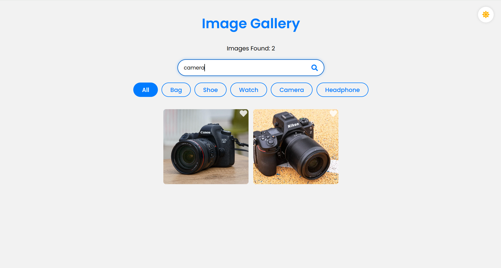
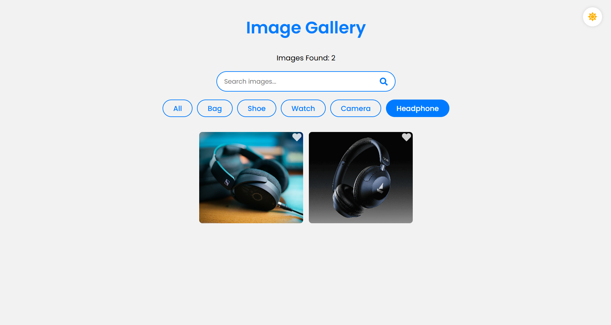
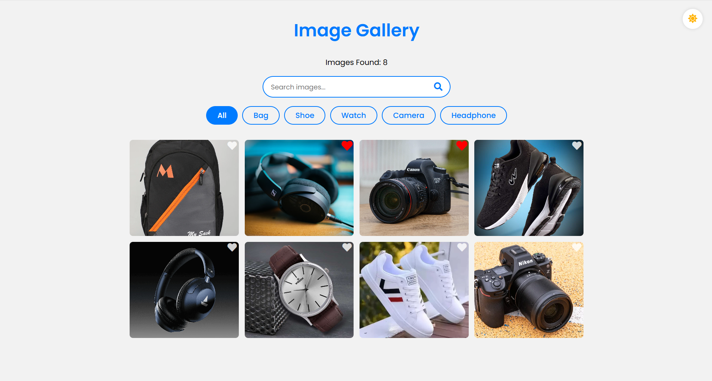
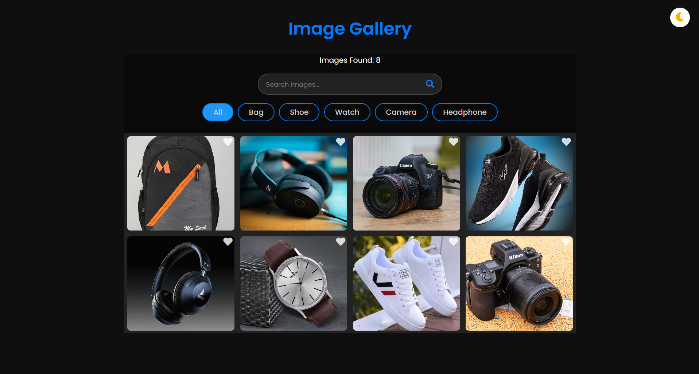

# 🖼️ Image Gallery

A fully responsive and interactive image gallery built using HTML, CSS, and JavaScript. It allows users to explore images, search and filter by category, mark favorites, download images, and switch between light and dark modes for a personalized browsing experience.

## ✨ Features

* 🖼️ **Responsive Gallery:** Displays images in a visually appealing layout across desktop, tablet, and mobile devices.
* 🔍 **Search Functionality:** Quickly find images using keywords.
* 🗂️ **Category Filters:** Filter images by category for easier navigation.
* ❤️ **Favorites:** Like and mark preferred images as favorites.
* 📥 **Image Download:** Download images for local use.
* 🌙 **Dark Mode:** Switch between light and dark themes.
* 🎨 **Interactive UI:** Enjoy a clean and user-friendly browsing experience.

## 🛠️ Tech Stack

* **HTML5** – Application structure
* **CSS3** – Styling, responsive layouts, and theme customization
* **JavaScript** – Search, filtering, favorites, download functionality, and event handling
* **Tools:** VS Code, Git, and GitHub

## 📸 Screenshots

### 1. Main Gallery Interface

Displays the image gallery with its layout, navigation, and category filters.

  

### 2. Search and Category Filters

Demonstrates the image search and category filtering functionality.

  

  

### 3. Favorite Images

Shows the gallery with liked or favorited images.

  

### 4. Dark Mode

Demonstrates the gallery's dark theme.

  

## 💡 Key Learnings

* Practiced DOM manipulation and event handling using JavaScript.
* Implemented search and category-based filtering.
* Developed interactive favorite and image download functionality.
* Worked with light and dark theme switching.
* Improved responsive web design and UI/UX skills.
* Strengthened frontend development fundamentals through hands-on implementation.

## 👨‍💻 Author

**Siddharth Singh**

* GitHub: [sidd-singh04](https://github.com/sidd-singh04)
* Live Project: [Image Gallery](https://codealpha-tasks-image-gallery.vercel.app/)
